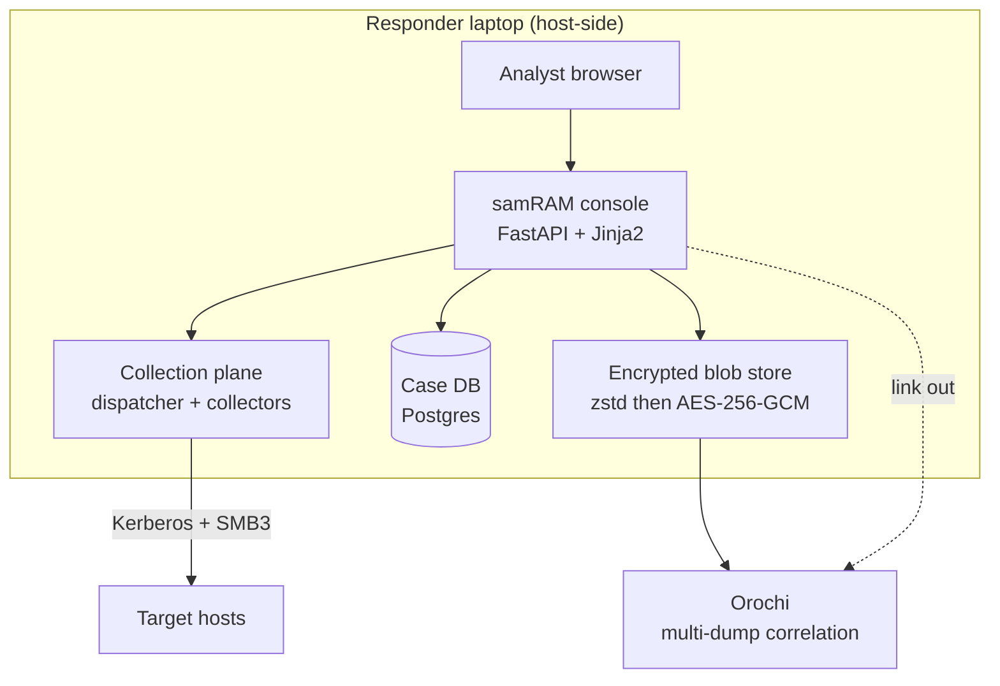
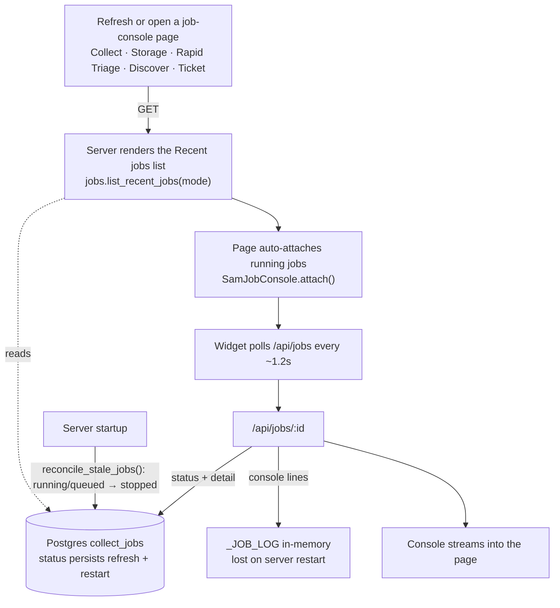
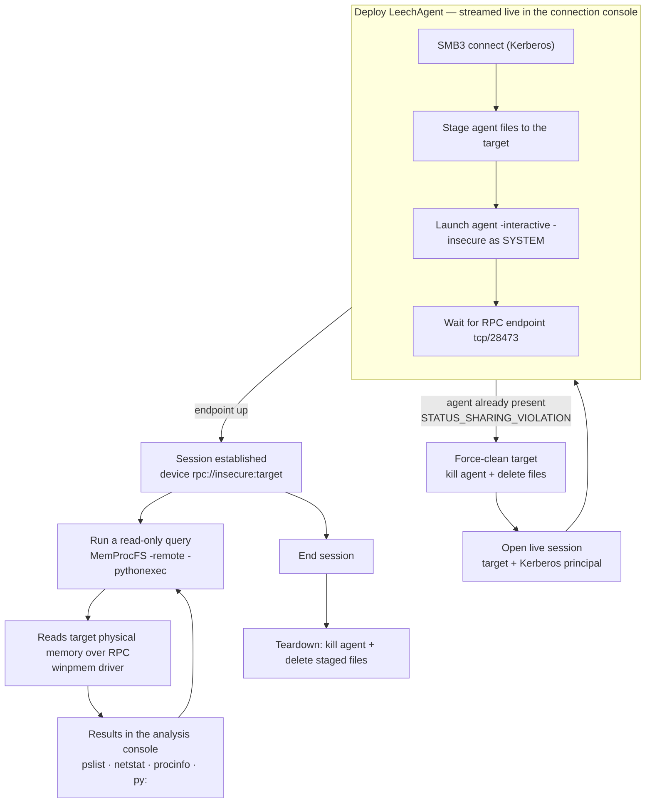

# samRAM

DFIR remote memory acquisition and analysis, driven from a single web console.

A responder runs samRAM from a laptop to enumerate an environment, confirm a host is
reachable, and then either pull a host's memory back for deep analysis or query it
live over the wire without writing anything to disk. It is a thin collection and
orchestration plane built in-house, sitting in front of a forked open-source
memory-analysis app (Orochi) for deep, multi-dump correlation.

## What it does

The console (`console/`) runs host-side (it needs host networking, a Kerberos ticket,
and the Windows MemProcFS client) and drives the collection engine directly. Pages:

- **Discover** - enumerate hosts in the target Active Directory.
- **Network & Connectivity** - DNS, ping, and the TCP ports collection needs (SMB,
  RPC, LeechAgent) with a PASS/FAIL verdict.
- **Memory Acquisition** - pull a full raw image over an encrypted SMB channel, verify
  it, and seal it into the encrypted store.
- **Remote Fileless Analysis** - deploy a temporary agent and query a host's live
  memory over the wire (MemProcFS); no image is written or pulled.
- **Vol3 Console / Strings** - interactive Volatility 3 plugins and string search over
  a stored dump.
- **Manage Local Storage** - the encrypted dump store, with export.
- **Vault / Kerberos Ticket** - an encrypted notepad for reused secrets, and TGT
  acquisition.

Every acquisition and analysis action is recorded to a per-dump sealed activity log
(encrypted at rest, bundled with the dump's export) so a remote analyst can see what
has already been checked.

## Architecture



- **Collection plane** (`collection/`): a `Collector` plugin contract driven through a
  uniform `probe -> deploy -> acquire -> verify -> teardown` lifecycle. Two collectors
  are live: `winpmem` (full raw dump) and `leechagent` (dumpless live / fileless).
- **Secure transport** (`secure_smb.py`, `remote_capture.py`): Kerberos-only, SMB3
  encryption asserted fail-closed, end-to-end SHA-256 integrity.
- **Storage** (`storage/`): streaming zstd -> AES-256-GCM envelope encryption. Each
  dump has its own data key, wrapped by a runtime master key that is never written to
  disk. Content-addressed by plaintext SHA-256 (the custody anchor).
- **Case DB** (`storage/schema.sql`): Postgres holds custody records, blob metadata,
  job history, and the activity-log index. It never holds raw memory or credentials.
- **Analysis**: full dumps are handed to a forked Orochi (Django + Dask + Postgres +
  Redis) for multi-dump correlation; the console links out to it.

See `docs/ARCHITECTURE.md` for the full design and `docs/ROADMAP.md` for status.

## Key flows

### Job persistence + reattach

Every acquisition/analysis action runs as a background job recorded in Postgres and
streams its console from an in-memory buffer. A page refresh (or reopening a page)
re-renders the recent-jobs list from the DB and reattaches the live console to any job
still running — so nothing is lost. See `docs/refreshpersistence.md`.



### Live analysis (Remote Fileless Analysis)

Deploy the LeechAgent once, then run read-only MemProcFS queries against the target's
live memory over RPC — dumpless, nothing written to the target's disk.



## Getting it running on a laptop

Step-by-step, from nothing to a working console. Every script here is idempotent, so
you can re-run any step safely.

**1. Get the code onto the laptop.**
```bash
git clone https://github.com/YOUR-USERNAME/samRAM samRAM && cd samRAM
```
Everything needed is in the repo, including the compiled binaries - no separate
downloads and no source builds.

**2. Provision the platform (skip if it's already set up).**
samRAM needs WSL2 (Ubuntu), Docker Desktop, and Python 3.12. If the laptop already has
them, go to step 3. Otherwise run the catch-all provisioners - they check what's
present and install only what's missing (diagram + detail in `docs/PROVISIONING.md`):
```powershell
# Windows, Administrator PowerShell - installs WSL2 + Docker Desktop if missing:
powershell -ExecutionPolicy Bypass -File provision-windows.ps1
```
Reboot if it asks, launch Docker Desktop once (enable Settings > Resources > WSL
Integration), then in Ubuntu (WSL):
```bash
bash provision-wsl.sh      # installs missing system tools, then runs setup.sh for you
```
`provision-wsl.sh` already does step 3 - jump to step 4.

**3. Install samRAM.** From the repo folder in WSL:
```bash
bash setup.sh              # creates the venv, installs deps, verifies bundled binaries
```

**4. Set your two secrets.** `setup.sh` created `.env.local`. Generate a store master
key once and set both values in that file:
```bash
source ~/samram-venv/bin/activate
python -c "import storage.crypto as c; print(c.generate_master_key())"   # -> SAMRAM_MASTER_KEY
```
Edit `.env.local`: paste that into `SAMRAM_MASTER_KEY`, and set `KRB5CCNAME` to your
Kerberos ticket-cache path. Keep the master key safe - without it the dump store is inert.

**5. Start it.**
```bash
./start.sh                 # brings up Postgres + Redis and the console
```
Open http://localhost:8800.

**6. Get a ticket, then work.** In the console open **Kerberos Ticket** and acquire a
TGT (the password is used once, never stored). Then follow the sidebar top-to-bottom:
**Discover** hosts, **Network & Connectivity** to confirm reach, then **Memory
Acquisition** (pull a dump) or **Remote Fileless Analysis** (live, no dump), and
analyze with **Vol3 Console** / **Strings**.

## Bundled binaries (no build required)

MemProcFS, LeechCore/LeechAgent, and go-winpmem ship no easy prebuilts and normally
have to be compiled from source. To spare that, the **compiled binaries are committed
to this repo** (`memprocfs/`, `LeechCore/files/agent/x64/`, `go-winpmem_*.exe`), so a
clone is self-contained and needs no build toolchain. `setup.sh` verifies them against
`deploy/vendor.sha256`. What is deliberately not committed: MemProcFS's runtime symbol
cache (`memprocfs/Symbols/`, refetched on demand) and the LeechCore upstream source.

Paths are configured in `console/config.py` via the `SAMRAM_*` environment variables.

## Security model

- **Credentials are Kerberos-only.** A password is used once to mint a ticket and is
  never stored, logged, or written to disk. Nothing credential-bearing reaches an
  image, its sidecar, the logs, or the DB.
- **Memory images are encrypted at rest.** Losing the laptop leaks only ciphertext;
  without the master key the store is inert.
- **Chain of custody.** Every acquisition is SHA-256 hashed and fully logged
  (who / what / when / which tool+version / which device string); `verify` gates
  analysis and catches truncated or torn dumps.
- **Clean teardown.** Agent-leaving collectors remove everything they staged, even on
  mid-run failure.

## Repository layout

```
console/        host-side FastAPI web console (the UI)
collection/     collector contract + dispatcher + winpmem / leechagent collectors
storage/        envelope crypto, blob store, sealed activity logs, case-DB schema
enumeration/    Active Directory host enumeration
secure_smb.py   Kerberos-authenticated, SMB3-encrypted transport
remote_capture.py   full-dump capture over SMB
deploy_leechagent.py  agent deploy/teardown over SMB + SCM
deploy/         docker-compose for the case DB (Postgres + Redis)
docs/           ARCHITECTURE.md, ROADMAP.md
```

## Status

Working: the analysis half end-to-end (capture -> custody -> encrypted store ->
Orochi), both collectors, secure transport, live fileless triage, and the full web
console with per-dump activity logging. In progress: multi-host concurrency and the
"mark hosts and hunt" sweep. See `docs/ROADMAP.md`.
